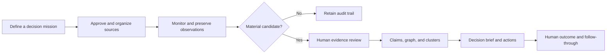
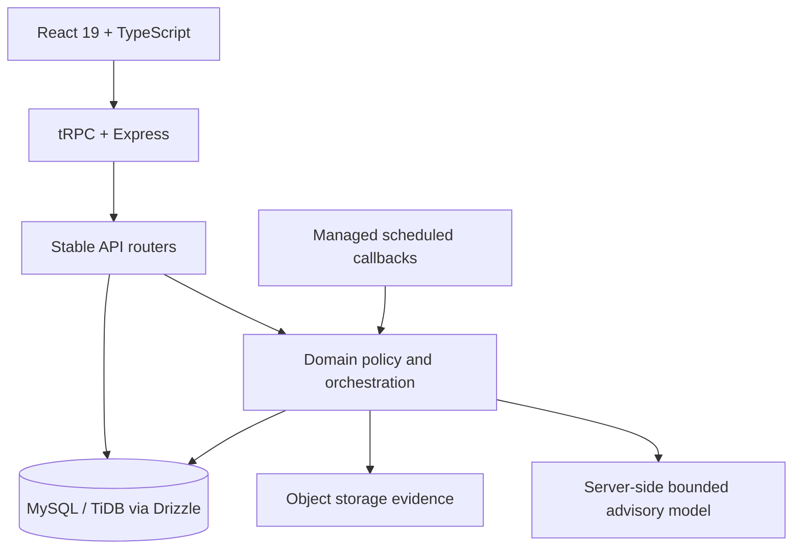

# Research Intelligence Platform

> **Know what changed. Keep the evidence. Let a human decide.**

Research Intelligence Platform is a private, evidence-to-decision workspace for monitoring approved external sources, preserving change evidence, identifying material changes, and turning verified signals into human-owned decision briefs and accountable follow-through.

It is designed for recurring research problems such as career intelligence, procurement and policy monitoring, technical/vendor research, and operational change tracking. It is **not** an autonomous action system: models are advisory only, external escalation remains confirmation-gated, and every consequential outcome remains owned by a reviewer.

## What it does

| Capability | Practical outcome | Built-in safety boundary |
|---|---|---|
| Approved-source monitoring | Checks public JSON APIs, HTML pages, RSS, and plain text on managed schedules. | URL validation, parser constraints, rate controls, and paused-by-default onboarding. |
| Durable evidence | Preserves artifacts, normalized observations, hashes, structured diffs, and immutable review context. | Evidence is not overwritten by notes, decisions, or advisory text. |
| Human review | Lets a reviewer confirm, reject, or request follow-up for material candidates. | Only confirmation can request an owner alert; no dashboard view silently escalates. |
| Evidence-to-decision missions | Connects claims, entity relationships, clusters, briefs, accountable actions, and outcomes. | Entities and relationships need owned evidence; decision actions never execute external systems. |
| Bounded advisory investigation | Summarizes selected preserved claims and authorized linked change metadata. | Server-only model calls, strict citation validation, uncertainty labels, no browsing, no tools, no automatic writes. |
| Governance workflows | Supports collections, tags, batch source preview, alert rules, annotations, comparison, and anomaly triage. | All records are owner scoped; matches prioritize review rather than triggering action. |
| Reports and distribution | Produces filtered CSV/PDF reports and optional Slack/email scheduled delivery. | Secrets are never stored in code; schedules stay paused until provider readiness is confirmed. |

## Product workflow



The built-in **How to use this workspace** page provides an on-site, route-aware onboarding sequence and reads only real workspace state. It does not seed example sources, research claims, decisions, outcomes, or delivery events.

## Architecture

The deployment is one autoscaled Node service with React in the browser, tRPC as the typed API boundary, Express for HTTP/runtime integration, Drizzle for MySQL/TiDB persistence, object storage for preserved artifact bytes, and managed scheduled callbacks for recurring checks and report delivery.



### Directory guide

```text
client/src/
├── pages/                 # Route-level workspaces
├── components/            # Reusable workflow UI and dashboard shell
├── lib/                   # Pure browser helpers and tRPC client
└── contexts/              # Presentation-state providers

server/
├── _core/                 # Runtime, OAuth, tRPC context, managed integrations
├── domains/               # Explicit domain policy boundaries
│   ├── source-governance/ # Owner-scoped source and collection access guards
│   └── mission-control/   # Owner-scoped mission and decision-brief access guards
├── monitoring/            # Monitoring, normalization, delivery, scheduled orchestration
├── intelligence/          # Deterministic alert matching
├── routers/               # Stable tRPC contracts and request composition
├── db.ts                  # Database connection and runtime lookup helpers
└── storage.ts             # Object storage boundary

drizzle/
├── schema.ts              # Database schema as source of truth
└── *.sql                  # Reviewed, applied migrations

docs/
├── architecture-assessment-and-upgrade.md
├── product-reframing-and-advanced-roadmap.md
├── real-world-setup.md
└── verification.md
```

The `server/domains/` directory is intentionally small. It centralizes **authorization policy** first, while public tRPC paths stay stable. This avoids a risky “rewrite everything” while giving future refactors a clear home for subdomain logic.

## Safety, security, and decision controls

| Concern | Control |
|---|---|
| Tenant/workspace isolation | Protected procedures use the authenticated user and domain ownership guards before exposing or mutating source, collection, mission, brief, claim, relationship, or action data. |
| External-source safety | Only approved public HTTP(S) sources are accepted; unsupported/private targets and malformed configuration are rejected. |
| Evidence integrity | Artifacts live in object storage; metadata, hashes, versions, observations, diffs, and reviews remain durable in the database. |
| Human authority | An advisory response cannot change status, create an action, send a message, or execute a third-party workflow. |
| Model containment | Model calls are server-side, context bounded, structured, citation checked, and explicit about uncertainty and unsupported gaps. |
| Scheduled work | All recurring execution uses managed authenticated callbacks. The application does not use in-process timers or `node-cron`. |
| Delivery safety | Slack/email credentials are stored only as secrets; schedules are paused until readiness is validated and the user intentionally activates them. |

## Local development

### Prerequisites

Use Node.js 22+ and pnpm. The managed environment injects application, authentication, storage, database, and advisory-model configuration. Do **not** commit `.env` files or provider tokens.

```bash
pnpm install
pnpm dev
```

The development server runs the Express/tRPC runtime and Vite integration from `server/_core/index.ts`.

### Quality gates

```bash
# Run the full test suite
pnpm test

# Check TypeScript contracts
pnpm check

# Build the browser and server bundles
pnpm build
```

Run all three before saving a checkpoint or publishing a new revision. Tests include pure-helper coverage and database-backed ownership, evidence-boundary, retrieval-citation, alert, batch-import, annotation, and anomaly safeguards.

### Database changes

The schema in `drizzle/schema.ts` is authoritative. For a schema change:

1. Update the schema deliberately.
2. Generate a migration with Drizzle.
3. Read the generated SQL and assess data-loss risk.
4. Apply the migration in dependency order.
5. Add or update tests and verify the application.

Avoid destructive migrations unless a recovery plan and explicit approval exist.

## Real-use onboarding

1. Open **How to use this workspace** and define the decision you need to make.
2. Create a general, career, or procurement/policy mission; do not add speculative sources.
3. Add trusted public sources individually or use **Intelligence** batch preview. Every accepted batch source starts paused.
4. Configure parsers and materiality policy, capture a baseline, then activate only sources you intend to monitor.
5. Review material candidates in **Change review**. Preserve context with append-only annotations and compare related owned events where useful.
6. In **Mission Control**, turn reviewed evidence into claims, evidence-backed relationships, reviewer-controlled clusters, and a decision brief.
7. Assign accountable action cards and record human outcomes. The platform does not execute those actions for you.
8. Use **Reports** for sharing. Keep scheduled Slack/email delivery paused until secure provider credentials and a deliberate test are available.

The detailed operational checklist, delivery-readiness instructions, and recovery behavior are in [`docs/real-world-setup.md`](docs/real-world-setup.md).

## Alert and anomaly governance

Alert rules can scope to all owned sources, one source, one tag, or one collection. They support minimum materiality, keyword matching, severity, cooldown, and post-confirmation owner-alert eligibility. A match is an attention signal—not a decision and not an external send.

Deterministic anomaly scans compare observed daily material changes or failed fetches with a six-day baseline and surface the threshold in the finding. A reviewer may acknowledge or dismiss only their own finding.

## Scheduled operations

| Job | Responsibility | Invariant |
|---|---|---|
| Source check | Runs one approved source check. | Authenticates the scheduled request and resolves a source by task identifier. |
| Reconciliation | Repairs abandoned runs and retries persisted notification failures. | Never duplicates a successful channel send. |
| Report delivery | Compiles and sends a scheduled report when explicitly enabled. | Requires provider readiness and follows selected fallback order. |

## Architecture evolution

Read [`docs/architecture-assessment-and-upgrade.md`](docs/architecture-assessment-and-upgrade.md) for the principal-level assessment, considered alternatives, trade-offs, and the selected domain-policy modularization. The next intended evolution is extracting monitoring query aggregation and mission subrouters only after this small structural slice has proven stable.

## Current limitations and intentional non-goals

- Live Slack/email delivery is intentionally unverified until credentials are supplied and a deliberate paused test schedule is run.
- The platform is not a browser crawler, autonomous procurement agent, job application bot, or decision engine.
- Advisory output is not a source of truth and cannot replace preserved evidence or reviewer judgment.
- Autoscaled deployment is stateless; recurring work belongs in managed scheduled callbacks, not in server memory.

## Contributing principles

When changing this codebase, favor small contract-preserving increments. Keep ownership checks at a discoverable domain boundary, preserve evidence rather than overwriting it, treat external content as untrusted, and require a human to authorize any consequential transition or outbound action.
