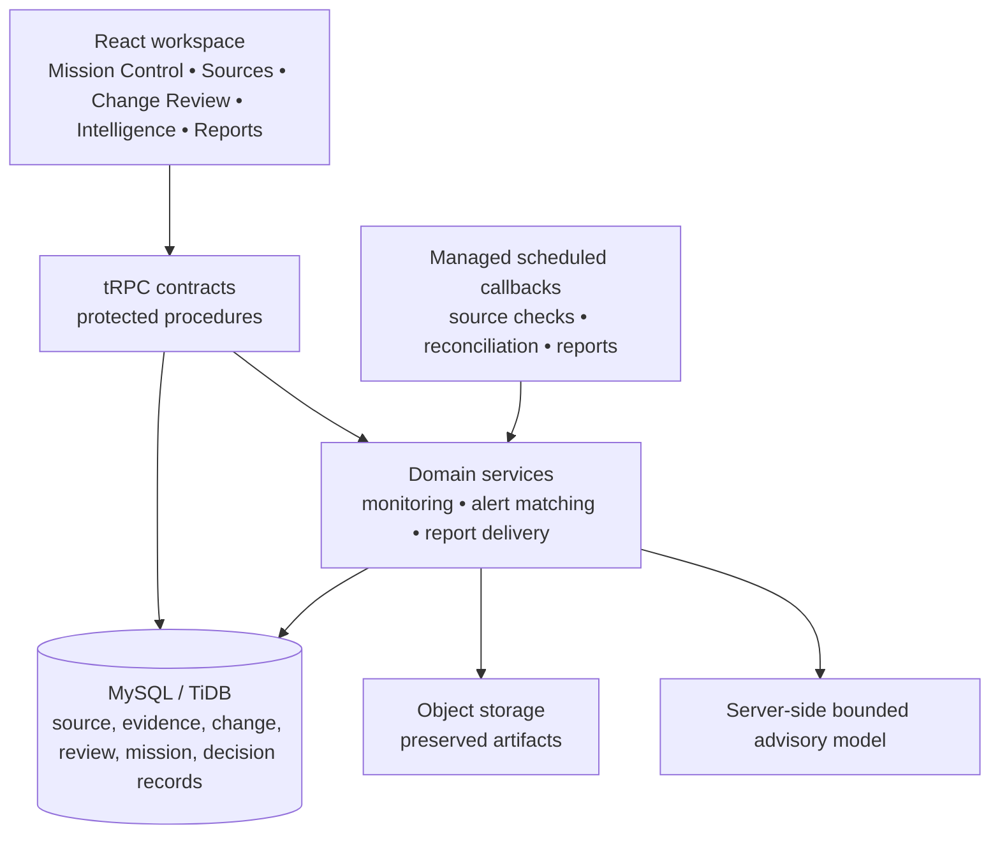

# Principal Architecture Assessment and Upgrade Decision

## Executive assessment

The platform has a sound **evidence-to-decision core**. Its runtime entrypoint is deliberately thin; transport concerns are separated through tRPC, OAuth, object-storage proxying, and managed scheduled endpoints; the database captures durable evidence and append-only review context; and consequential decisions remain owned by a human reviewer. These are the right foundations for a production research-intelligence workspace.

The main maintainability risk is not product scope. It is **boundary erosion inside growing router modules**. The monitoring router currently holds source lifecycle, dashboard/query composition, review, operations, report templates, delivery configuration, and schedule activation. The mission router exposes a coherent product surface but is deliberately compressed, so its ownership guards, validation, investigation boundaries, clustering, briefs, and actions are costly to change safely. Similar source and collection ownership logic appears in more than one router.

> The governing architectural rule remains: **a request must establish ownership and evidence scope before it can read, mutate, schedule, explain, or escalate a record.**

## Current architecture



| Area | What is working well | Principal-level concern |
|---|---|---|
| Runtime composition | The Express entrypoint stays thin and explicit. | It depends on router modules remaining disciplined. |
| Evidence and review | Preserved artifacts, change events, append-only review, and mission claims make the audit trail durable. | Ownership checks must remain uniform as more procedures are added. |
| Scheduling | Managed callbacks are authenticated and look up business records by task identifier. | This boundary should remain thin; no in-process jobs should leak in. |
| Advisory model use | Server-only, bounded context, strict citation validation, and no action path are correct safeguards. | Retrieval and authorization code is sensitive to accidental scope drift. |
| Router layout | Public API names are stable and grouped by product domain. | Direct database access plus locally defined guards creates duplicated policy enforcement. |
| Frontend composition | Route pages increasingly delegate to focused workspaces. | Large feature surfaces should continue to use feature-local components and pure helpers. |

## Alternatives considered

| Upgrade option | Advantages | Drawbacks | Decision |
|---|---|---|---|
| **A. Documentation only** | Near-zero regression risk; clarifies intent. | Does not remove duplicated authorization policy or lower change cost. | Rejected as insufficient. |
| **B. Domain-owned access guards and contracts, with stable router composition** | Centralizes owner/record invariants; reduces duplicated queries; establishes a scalable directory pattern; preserves existing tRPC API contracts and database schema. | Adds indirection; requires careful regression testing because access control is security-sensitive. | **Selected.** |
| **C. Full clean/hexagonal rewrite with repositories, ports, commands, queries, and event bus** | Clear theoretical separation; easier independent unit testing at large scale. | High migration cost; duplicate abstractions over Drizzle; risks slowing product work and introducing parity defects. | Deferred. |
| **D. Microservices or async event platform** | Independent scaling and fault isolation for very high throughput. | Operational overhead, distributed tracing, event consistency, and cost are unjustified for the current autoscaled single-service deployment. | Rejected for current stage. |
| **E. Frontend feature-folder rewrite first** | Can improve feature locality. | The meaningful current risk is server-side authorization and router complexity, not route registration or visual components. | Deferred. |

## Selected upgrade: domain-owned policy boundaries

The approved upgrade creates a `server/domains/` layer for **explicit ownership policy**, without changing a single tRPC procedure name, request shape, response shape, database table, scheduled endpoint, or client query key.

```text
server/
├── domains/
│   ├── source-governance/
│   │   └── ownership.ts      # owned source and owned collection guards
│   └── mission-control/
│       └── ownership.ts      # owned mission and owned decision-brief guards
├── routers/
│   ├── monitoring.ts         # remains contract/composition focused
│   ├── intelligence.ts       # delegates ownership checks
│   └── missions.ts           # delegates mission and brief ownership checks
├── monitoring/               # orchestration, normalization, delivery, scheduled handlers
└── _core/                    # framework/runtime integration only
```

This first slice is intentionally modest. It removes duplicated access-policy implementations from three high-value routers, makes authorization invariants discoverable by domain name, and produces a safe precedent for future extraction of monitoring query/services and mission subrouters. It does **not** pretend that every query needs a repository abstraction today.

## Guardrails and acceptance criteria

The refactor is acceptable only when the following remain true:

1. Existing tRPC paths and client contracts are unchanged.
2. Every guarded record lookup still filters by the authenticated owner before mutation or disclosure.
3. Mission briefs remain reachable only through an owned mission.
4. Source collections remain reachable only through their owner.
5. Scheduled handlers, server-only model calls, artifact storage, and external delivery behavior are unchanged.
6. Focused ownership tests and the full test, type-check, and production-build suite pass.

## Next architectural increments

After this upgrade proves stable, the next rational slices are to extract monitoring query aggregation from `server/routers/monitoring.ts`, split the mission router into contract-preserving subrouters, and add static architecture checks that prohibit browser-side LLM calls and unowned record mutations. A microservice transition should be evaluated only when measured workload, SLO, or deployment isolation needs justify it.
